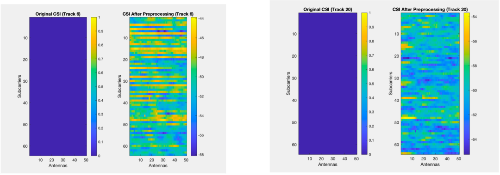
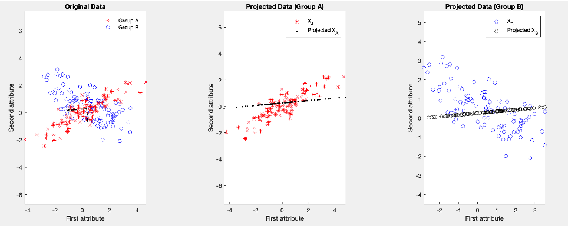
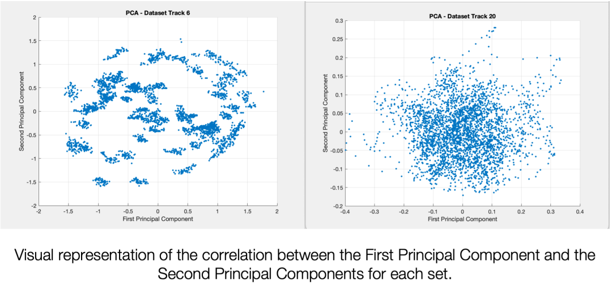
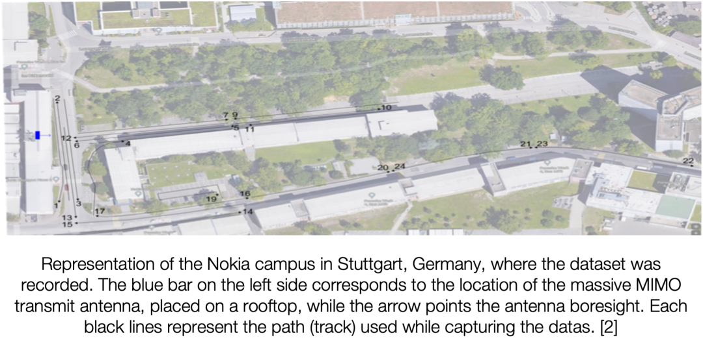

# New paradigm of 6G physical layer security: PCA decomposition of CSI, unlocking integrated research on authentication and key generation[with MATLAB code]

6G Physical Layer Security New Paradigm: PCA Decomposes CSI, Unlocking Integrated Research on Authentication and Key Generation
In the research track of 6G wireless communication physical layer security (PLS), the value mining of channel state information (CSI) has always been a core direction. For a long time, the academic community has mainly focused on one dimension of application for CSI—either extracting features to create radio fingerprint authentication or capturing random characteristics to generate keys, neglecting the dual nature of CSI, which is both device determinacy and environmental randomness.
Our team's research on preprocessing CSI using Principal Component Analysis (PCA) has achieved an integrated framework for large-scale fading characteristics for radio fingerprint authentication and small-scale fading residuals for key generation. This method was validated on real Massive MIMO datasets, providing a new path for the implementation of PLS in 6G. This paper will share the insights and gains from this research from four dimensions: research pain points, core methods, practical experiences, and future directions. We hope it can provide references for scholars and graduate students in related fields.
1. Research Pain Points: Why Do We Need to "Split and Utilize" CSI? The requirements of 6G wireless security have already transcended the scope of traditional top-layer encryption—the lightweight authentication of massive IoT devices, ready-to-use keys in air interface transmission, and anti-eavesdropping physical layer native protection all require us to re-examine the value of CSI:
Large-scale fading (path loss, shadow effect) has device uniqueness and environmental stability, making it a natural radio fingerprint. However, previous researches are often distracted by the randomness of small-scale fading, leading to insufficient robustness in authentication features;
Small-scale fading (multipath effects, fast fading) possesses strong randomness, making it a good source of entropy for key generation (SKG). However, when extracted alone, it is affected by the trend of large scale, making its randomness and independence difficult to meet security requirements.
The traditional research has divided the two core characteristics of CSI, which not only leads to the waste of data resources but also makes it difficult to adapt to 6G's requirements for an integrated security system, lightweight, and real-time. Our core idea is: Can we effectively split the predictable and unpredictable parts of CSI through efficient dimensionality reduction methods, allowing the former to focus on authentication and the latter on key generation?
PCA has become the optimal solution to this problem—it maximizes the retention of the main variance (corresponding to large-scale fading) through orthogonal transformation, while extracting random components (corresponding to small-scale fading) through residuals, and its linear operation perfectly fits the real-time requirements of communication systems, providing a simple yet feasible framework for the dual-dimensional use of CSI.
Step Two: Core Methodology: PCA Decomposition of CSI in Five Key Steps
Many graduate students initially encounter this direction may easily fall into the trap of "formula stacking," but in fact, the core logic of PCA processing CSI can be summarized into five practical steps that balance academic rigor with engineering feasibility. All derivations strictly follow the operational norms of complex domain PCA:
1. Data Preprocessing: Reshape CSI into a format that PCA can handle. In massive MIMO scenarios, CSI is a 3D complex matrix (64 subcarriers×50 antennas×6000 time samples), the first step is to reshape it into a 2D matrix (3200=64×50), and only keep the real part involved in PCA computation:
This seemingly basic step is crucial for subsequent analysis: Directly computing covariance with complex matrices will introduce redundant dimensions due to conjugates, significantly reducing decomposition efficiency, which was an important pitfall we encountered in our initial research.
2. Covariance Matrix and Eigen Decomposition: Capturing the "Main Trend" of CSI
Calculate the empirical covariance matrix of the real part matrix of CSI, then obtain the eigenvalues and eigenvectors through eigen decomposition, this step is the core of PCA extracting principal components:
The conjugate transpose of the matrix, the eigenvalues, and the eigenvectors. The selection of eigenvalues is crucial: our experiments have found that the first ten principal components can capture 96.56% of the variance in NLOS scenarios and 79.77% in LOS scenarios, indicating that the first ten eigenvectors are sufficient to represent the predictable part of CSI (large-scale fading).
3. Predictable Component Reconstruction: The core carrier of radio frequency fingerprint is constructed by the previous feature vectors to form a projection matrix, and thenCSIProjection to low-dimensional space and then reconstructing, resulting in predictable components.:   
It contains the projection matrix for the previous feature vector. This part of the data eliminates small-scale random fluctuations. Retains the inherent characteristics of the equipment and environment. It is the core carrier of RF fingerprint authentication.
4. Residual Extraction: The source of entropy for key generation is the original CSI matrix minus the predictable components. Retrieve the residuals. This is the "pure random component" after CSI eliminates deterministic trends:
To ensure the residuals are suitable as an entropy source for SKG, we have completed two key statistical verifications, which are also more important than the numerical indicators in physical layer security research:
Gaussianity verification: The residual distribution conforms to a Gaussian distribution, meeting the statistical characteristics requirements of random sources for key generation.
Correlation Analysis: The Pearson correlation coefficient is used to measure the statistical independence of residuals. In NLOS scenarios, the average correlation coefficient of residuals is only 0.01954, while in LOS scenarios it is 0.05362. Low correlation indicates that the different subcarrier/antenna dimensions are independent, providing ample entropy values.
5. The implementation of certification and key generation is based on the splitting of the original, separately implementing radio frequency fingerprint authentication and key generation to form a complete PLS framework:
1  
Radio-Frequency Fingerprint Authentication: Input the predictable components into the K-means clustering model, classify devices by minimizing the Euclidean distance, where the centroid of each cluster is denoted as.
2  
Key Generation: Residuals are quantized to 1 bit (converted to a 0/1 binary sequence based on the median threshold), achieving key generation.
1  
Indicator Quantification: The certification effectiveness is measured by classification accuracy, and the consistency of keys (for both parties) is measured by mismatch probability.
III. Experimental Results: Verification and Discoveries on Real Datasets
The experiments in this study are based on the publicly available Massive MIMO real measurement dataset from Nokia (Track 6 NLOS, Track 20 LOS), which includes CSI data for 64 subcarriers × 50 antennas × 6000 time samples. All indicators are the average of multiple repeated experiments to ensure reproducibility of the results.
1. Core Experiment Indicators: Experimental Scenarios
- Number of principal components
- Variance retention rate
- Residual mean correlation coefficient
- Key mismatch probability
- Radio frequency fingerprint authentication accuracy
- Track 6 (NLOS)
- 10
- 96.56%
- 0.01954
- 0.5146
- 20.1875%
- Track 20 (LOS)
- 10
- 79.77%
- 0.05362
- 0.38477
- 19.6875%
2. Key Findings:
1. PCA dimensionality reduction efficiency: The first 2-3 principal components can capture most of the predictable variance of CSI, proving that PCA can efficiently achieve feature decomposition of CSI, meeting the requirements of lightweight communication systems;
2. Impact of scenarios on PLS: The residual randomness in the NLOS scenario is stronger and the correlation is lower, making it more suitable for key generation; the channel conditions in the LOS scenario are more stable, and the features of predictable components are clearer, making it more suitable for radio frequency fingerprint authentication;
3. Theoretical rationality of indicators: The key mismatch probability in the NLOS scenario is closer to the ideal value of 0.5, which is a direct manifestation of its strong randomness, not a methodological flaw—the core of physical layer key generation is the unpredictability of random sources, not just a low mismatch rate (mismatch can be optimized through privacy amplification techniques).
IV. Practical Experience: Three Pitfalls to Avoid for Graduate Students Entry into Research
1. Do not blindly trust built-in functions. Manual implementation is key to understanding the essence. Although MATLAB's PCA() function is convenient, However, calling it directly will ignore the conjugate transpose of the matrix in the plural domain. The physical significance and key details of feature value screening. We initially used the built-in functions directly. Causes the decomposition results to deviate from theoretical deductions. Subsequently, the covariance matrix is manually calculated. Feature decomposition The full process of project reconstruction. I truly understand why the main component can characterize large-scale fading.
2. The selection of the dataset determines the validity of the conclusion. Avoid misjudgment in a single scenario if only LOS or NLOS single dataset is used for experiments. It is easy to make the misjudgment that "PCA is ineffective" - for example, when only using NLOS datasets. The certification accuracy is low. However, if combined with the analysis of scene characteristics. It will find that the entropy source of its key generation is of higher quality. Compare the experimental results of different channel scenarios. Only by objectively evaluating the performance of methods can This is also the basic criterion for research on physical layer communication.
3. Statistical verification is more important than the numerical values of indicators. Reject the "Accuracy-Only" Approach Many beginners overly focus on the accuracy of radio frequency fingerprint authentication or the mismatch probability of keys. However, they have overlooked the Gaussian nature of residuals. Independent verification. The core of physical layer security is the unpredictability of random sources. If the statistical characteristics of residuals are not up to standard, Even the highest certification accuracy has no practical security significance—this is the core difference between physical layer security research and traditional machine learning classification research.
V. Future direction: From linear splitting to nonlinear enhancement. Moving towards engineering implementation, the current linear PCA framework has verified the feasibility of CSI dual-dimensional utilization. However, the nonlinear characteristics of millimeter-wave/terahertz channels in 6G communication. Complex multipath environmental interference, Real-time engineering requirements. We are all required to further optimize and expand the methods. Future research focuses on four main directions:
1. Optimization and Verification of Kernel PCA (KPCA) with Gaussian Kernel Function KPCA can capture multipath nonlinear characteristics in NLOS scenarios. We have completed the preliminary implementation of KPCA. Subsequent optimization will focus on the nuclear parameters (such as gamma values). Compare the performance of KPCA and linear PCA under different channel scenarios. At the same time, evaluate its computational complexity trade-off.
2. Deep Learning and PCA Integration: Self-encoding neural networks based on deep learning can more precisely separate the deterministic and random components of CSI, especially suitable for high noise and strong nonlinear 6G channel scenarios. Future research will focus on the architectural design of deep self-encoding networks to achieve nonlinear splitting of CSI features, thereby enhancing authentication accuracy and key entropy values.
3. Advanced security indicators and optimization techniques are integrated with the introduction of dHSIC (Hilbert-Schmidt Independence Criterion) to achieve stronger residual independence verification than Pearson correlation coefficient.
Add privacy amplification technology, optimize the mismatch probability of keys, and enhance the confidentiality of keys.
Explore multi-bit quantization schemes to enhance the key generation rate and adapt to the requirements of 6G high-speed communication.
4. The transition from laboratory research to the actual deployment of 6G requires addressing real-time performance and hardware compatibility issues:
Optimize the computation process of PCA to achieve real-time CSI splitting in Massive MIMO systems;
Exploring FPGA/ASIC hardware acceleration solutions to meet the lightweight requirements of wireless communication devices.
Integrate this framework with the 6G protocol stack to achieve integrated deployment of physical layer authentication and key generation.
VI. Final note: The core of physical layer security is to explore the value of the channel itself. Cannot rely solely on "supplementary encryption at the top layer." Instead, it should return to the channel itself - CSI as the "native data" of wireless communication systems. The uniqueness of its equipment and the randomness of the environment. It is the most valuable resource in physical layer security.
Our study represents a small step forward: through PCA for the refined division of CSI, enabling each core feature to be utilized effectively, achieving integrated authentication and key generation. For graduate students in related fields, the appeal of this research direction lies in its combination of solid matrix analysis and statistical learning foundations with engineering thinking that closely aligns with real communication scenarios—avoiding the trap of formulaic approaches and focusing on a closed-loop research process of "problem-method-validation" to produce truly valuable research.
Academic rigor statement 1
All mathematical derivations in this paper strictly follow the computational norms of complex domain PCA, complying with the complex matrix characteristics of channel state information;
2
All experimental results are based on the publicly available Massive MIMO real measurement dataset (Track 6 NLOS, Track 20 LOS) from Nokia, demonstrating strong reproducibility;
3
The conclusions of the study are limited to the parameter settings of this experiment (D=10, 5-class device classification, 1-bit quantization), and when generalizing to other scenarios, parameters need to be adjusted according to channel characteristics.
References
1
Srinivasan, M., Skaperas, S., & Chorti, A. (2021). On the Use of CSI for the Generation of RF Fingerprints and Secret Keys [EB/OL]. arXiv:2110.15415.
2
Srinivasan, M., et al. (2022). Smart Channel State Information Pre-processing for Joint Authentication and Secret Key Distillation [EB/OL]. arXiv:2206.00332.
3
Mayya, A., et al. (2023). A SKG Security Challenge: Indoor SKG Under an On-The-Shoulder Eavesdropping Attack [EB/OL]. arXiv:2305.09251.  

## Images

<!-- PAYMENT_BLOCK -->

## Get this dataset

- Payment link (Stripe): [Buy now](https://buy.stripe.com/3cs8yP7sY87d0vu9AB)
- Payment QR code: 

<!-- /PAYMENT_BLOCK -->
